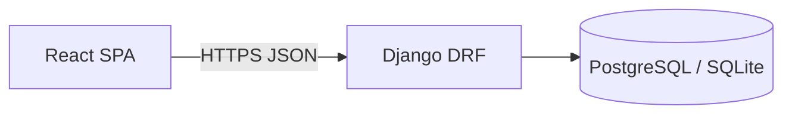

# Documento de arquitectura de software (SAD)

Version: 1.1 | Rama: modernizacion | Fecha: 2026-10-23

## 1. Introduccion

Medifast Pharmacy gestiona operaciones de farmacia comunitaria: usuarios por rol, colas de turnos, cajas, catalogo, facturacion y estadisticas. Arquitectura cliente-servidor: SPA React consume API REST Django.

## 2. Objetivos de arquitectura

- Preservar funcionalidad academica original.
- Separar configuracion por entorno sin secretos en Git.
- Permitir desarrollo local SQLite y produccion PostgreSQL.
- Evolucionar calidad sin reescritura completa.

## 3. Vista C4 — Contexto

Actores: administrador, empleado/cajero, cliente. Sistema Medifast expone API HTTPS; BD relacional; despliegue historico Render + Vercel.

## 4. Vista C4 — Contenedores

## 5. Modulos backend

Ver `docs/arquitectura/modelo-datos.md` y `contratos-api.md`.

## 6. Frontend

Vite bundler, rutas en `App.jsx`, modulos API en `frontend/src/api/`, estado auth en `localStorage` (token).

## 7. Seguridad arquitectonica

Token DRF, CORS explicito, throttle login, handler errores, HTTPS forzado si `DEBUG=False`.

## 8. Despliegue

Ver `docs/despliegue/`. `render.yaml` y `vercel.json` en raiz (config infra, no documentacion).

## 9. Decisiones

Registro ADR en `docs/decisiones/`. Indice: `docs/arquitectura/decisiones-registro.md`.

## 10. Riesgos

- Formato error API dual durante transicion frontend.
- Credenciales historicas en tag backup — rotacion recomendada.
